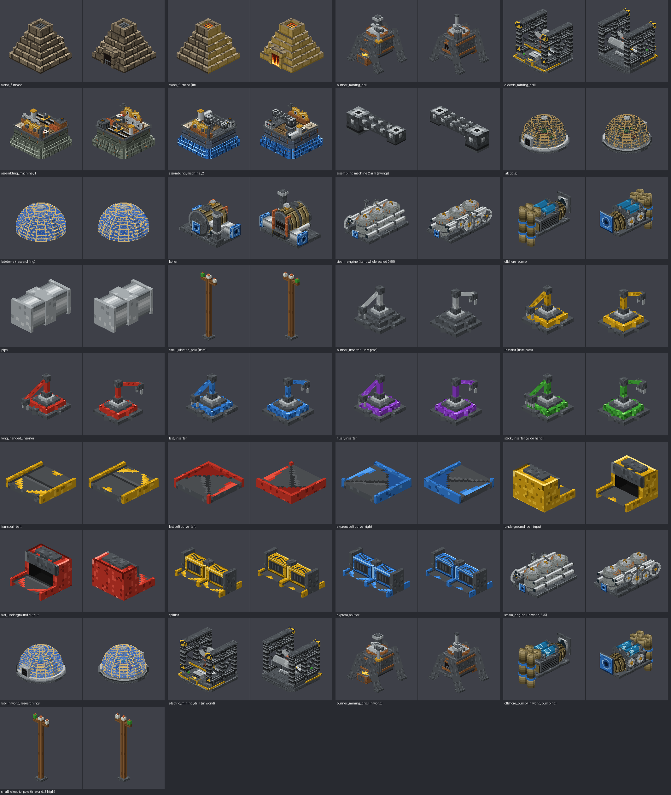

<div align="center">

# ⚙️ Minetorio

**Factorio внутри Minecraft. От первого лица.**

Добывай руду, тяни конвейеры, ставь манипуляторы и сборщики, исследуй технологии и защищай завод.
Цель проекта - вся прогрессия Factorio 1.1.110 до ракеты и полная военная часть.

Текущая версия: 0.4.0, рабочая ветка: `phase1`. Ракета и вся прогрессия пока не завершены.




</div>

---

## 🏭 Что это

Техно-модов для Minecraft много, но ни один не ощущается как **Factorio**. Minetorio честно переносит его механики:
конечная руда в залежах, видимые предметы на двух полосах конвейера, многоблочные машины, электросеть на столбах,
исследования за научные пакеты и, в дальнейшем, запуск ракеты как победа.

Рецепты и исследования берутся из Factorio 1.1.110, обычный режим (`normal`). Кусаки, гнезда, черви,
рейды, оружие, броня и оборона входят в общую цель. Переход на 2.0/Space Age отложен;
уже принятое исключение - сегменты жидкостей по модели 2.0.

Мод задуман как основа игры: ты постоянно ходишь, строишь, исследуешь и расширяешь фабрику.

## ✨ Что уже есть

| | Механика | Как в Factorio |
|---|---|---|
| ⛏️ | **Рудные поля** на поверхности: железо, медь, уголь, камень | у каждого блока свой запас, рукой — по 1 руде, пустой блок становится землёй |
| 🔩 | **Буры** твердотопливный 2×2 и электрический 5×5 | копают поле под собой, выход прямо на ленту |
| ➡️ | **Конвейеры** трёх скоростей, подземные, разделители, наклонные | две полосы, предметы лежат на ленте и едут |
| 🖱️ | **Протяжка лент и столбов** мышкой | зажал ПКМ и бежишь — лента укладывается сама |
| 🦾 | **Манипуляторы**: твердотопливный, обычный, длинный, быстрый, фильтрующий и пакетный | кладут на дальнюю полосу |
| 🔥 | **Каменная печь**, **сборщики 1–2** | рецепты и времена из Factorio 1.1 |
| ⚡ | **Пар**: насос на берегу, бойлер, паровой двигатель, столбы | нехватка энергии замедляет машины |
| 🔬 | **Лаборатории**, красная и зелёная наука, дерево исследований | исследования общие на весь мир |
| 🛠️ | **Ручной крафт с очередью** (R) | недостающие детали крафтятся сами |
| 🗺️ | **Карта** (M), **миникарта** и **радар** | радар открывает территорию со временем |
| 📘 | **Чертежи**, книги, библиотека и обмен строками; планировщики сноса и улучшений | копирование завода и строительство призраками |
| 🤖 | **Строительные и логистические дроны**, пять видов сундуков, личные запросы и робопорт | рецепты и исследования Factorio 1.1 |
| 💧 | **Жидкости**, трубы в 3D, подземные трубы, бак и помпа | сегменты по дизайну Factorio 2.0 |
| ☀️ | **Солнечные панели, аккумуляторы**, средние/большие столбы и подстанции | дневная генерация и запас энергии на ночь |
| 🛢️ | **Нефтяные поля, качалка, НПЗ и химзавод**, крекинг и ожижение угля | фракции, рецепты и исследования Factorio 1.1 |
| 🧪 | **Сталь, пластик, сера, кислота, батареи, красные схемы и синяя наука** | сборщик 2 работает с жидкостями и бочками; стальной сундук — 48 слотов |

В 0.2.0 добавлен первый бой:

- Пистолет, автомат и обычные магазины на 10 выстрелов. Автомат открывается исследованием military.
- Серверные попадания, расход патронов, дальность, препятствия и частота стрельбы. Остаток активного магазина сохраняется в оружии.
- Собственные сущности малых кусак и гнезд: погоня, укус, выпуск потомков и сохранение. Поселения подключены к генерации новых чанков Наувиса за безопасным стартом.
- Прицел, отдача, вспышка, трассер, эффекты попаданий и собственные синтезированные звуки.

Это первый бой, а не вся военная часть: дробовики, остальное оружие, броня, турели, другие размеры врагов,
черви, загрязнение, эволюция и рейды еще предстоят. На выделенном сервере проверены генерация и
сохранение одного поселения на seed 123, включая уничтожение и unload/reload/restart.
[Сценарий проверки](docs/verification/2026-10-29-combat-worldgen.md). Визуальное качество стрельбы требует плейтеста. [Управление, проверки и ограничения боя](docs/playtest-combat.md).

В 0.3.0 подготовлено ядро железной дороги: прямые, диагональные и кривые рельсы,
граф соединений, проверка пересечений и поиск маршрутов. Поездов, укладки рельсов в мире,
станций и сигналов пока нет. Это начало блока железной дороги.
В 0.4.0 добавлены точные семь рецептов, одиннадцать исследований и параметры поездов и топлива 1.1.110.
Предметы зарегистрированы, но их применение в мире еще предстоит. Железнодорожные рецепты закрыты
исследованиями; поздние тормоза сохраняют требования фиолетовой и желтой науки.

Синие ленты, ожижение угля и поздняя логистика сохраняют зависимости от еще не добавленной поздней науки.
Наличие предмета в креативе не означает доступность в выживании.

Также работают камера сверху и удалённое строительство. Ванильные рецепты, спавн мобов, голод и переходы в Незер/Энд отключены. Новый мир Наувиса создаётся по умолчанию: собственные биомы, деревья, камни, вода и обломки корабля со стартовым набором. Инвентарь инженера — 80 слотов, хотбар хранит ярлыки, окна машин показывают настоящие слоты и показатели работы.

Все модели машин — объёмные, в духе мода Create, с движущимися частями, и сделаны по настоящим картинкам из Factorio.

Скин инженера поставляется с модом. [Управление персонажем](docs/character-controls.md) · [Плейтест нового мира](docs/playtest-world-interface.md).

## 🎮 Управление

| Клавиша | Действие |
|---|---|
| `E` / `R` | инвентарь инженера, ручной крафт, логистика и статистика |
| `1–9`, `0` / `X` | выбрать ярлык / переключить ряд ярлыков |
| `Y` | исследования |
| `M` | карта |
| `ПКМ` (зажать) | протяжка лент и столбов |
| `ПКМ` по машине | интерфейс машины |
| `ЛКМ` с оружием | отдельный выстрел пистолета; удержание для автомата |

Для стрельбы держать одно оружие в основной руке. Магазины берутся из всех 80 слотов, ручной перезарядки нет.
Незаряженный стек оружия сначала разделить; активный остаток боеприпасов передается вместе с оружием.

## 🚀 Демо-мир

Команда `/minetorio demo` строит рядом витрину базового завода: добыча, плавка, энергия, сборка, наука, радар. Это не полное прохождение и не витрина всей военной части.
Подробности — в [docs/demo-world.md](docs/demo-world.md).

## 🗺️ Дорожная карта

| Этап | Что | |
|---|---|---|
| 1 | Буры, ленты, манипуляторы, печи, сборщики, пар, наука | ✅ |
| 1.5 | Рудные поля, карта и радар, наклонные ленты, протяжка | ✅ |
| 2 | **Чертежи**, вид сверху, удалённое строительство, **строительные дроны** | 🔧 слито, нужен плейтест |
| 3 | Нефть, пластик, красные схемы, сталь, синяя наука, солнце | 🔧 реализовано; плейтест автора |
| 4 | Логистические дроны и сундуки | 🔧 слито, нужен плейтест |
| 5 | Железная дорога | 🔧 ядро геометрии и маршрутов; интеграция предстоит |
| 6 | Модули и маяки, фиолетовая и жёлтая наука | ⏳ |
| 7 | Логическая сеть | ⏳ |
| 8 | Атомная энергия | ⏳ |
| 9 | 🚀 Ракетная шахта и запуск ракеты — победа | ⏳ |

Текущий блок - железная дорога: геометрия и маршруты готовы в ядре; далее нужна интеграция с миром и поездами. Первый бой 0.2.0 уже добавлен и проверен автоматически;
полная военная часть развивается по отдельным блокам вместе с поздним заводом.

Полный объем: [дорожная карта](docs/roadmap.md), [план до ракеты и войны](docs/superpowers/plans/2026-10-29-minetorio-rocket-and-war.md),
[контракт полноты 1.1.110](docs/factorio-1.1.110-completeness.md).

## 🧑‍💻 Сборка

Нужен JDK 21. **Переезд на другой компьютер и точка продолжения:** [docs/CONTINUE.md](docs/CONTINUE.md).

Начинать с ветки `phase1`, `main` отстает. На Windows:

```powershell
git clone --branch phase1 https://github.com/D1pex2/Minetorio.git
cd Minetorio
.\gradlew.bat test runGameTestServer build --console=plain
.\gradlew.bat runClient
```

На Linux/macOS из корня репозитория:

```bash
./gradlew test runGameTestServer build --console=plain
./gradlew runClient
```

Готовый мод: `build/libs/minetorio-0.4.0.jar`. Gradle и зависимости загружает Wrapper;
сгенерированные ресурсы включены в репозиторий, запускать генераторы для сборки не нужно.

Проверка 0.4.0 от 2026-10-29: 613 юнит-тестов, 347 обязательных GameTest и сборка прошли.
Клиентский плейтест этой версии отложен: GLFW не обнаружил доступный монитор. Автотесты не подтверждают
ощущение стрельбы, положение оружия и звук в игре. Открытые сценарии перечислены в
[playtest-combat.md](docs/playtest-combat.md).

Логика (ленты, рецепты, исследования, энергия) живёт в чистом ядре `dev.minetorio.core` без зависимостей от Minecraft
и покрыта юнит-тестами; поведение в мире проверяют NeoForge GameTests.
Текстуры и модели генерируются скриптами в [art/](art/README.md).

## 🙏 Благодарности

Вдохновлено [Factorio](https://factorio.com) от Wube Software и модом [Create](https://github.com/Creators-of-Create/Create).
Minetorio — фанатский проект и не связан с Wube Software или Mojang. Арт Factorio в репозиторий и мод не входит.
